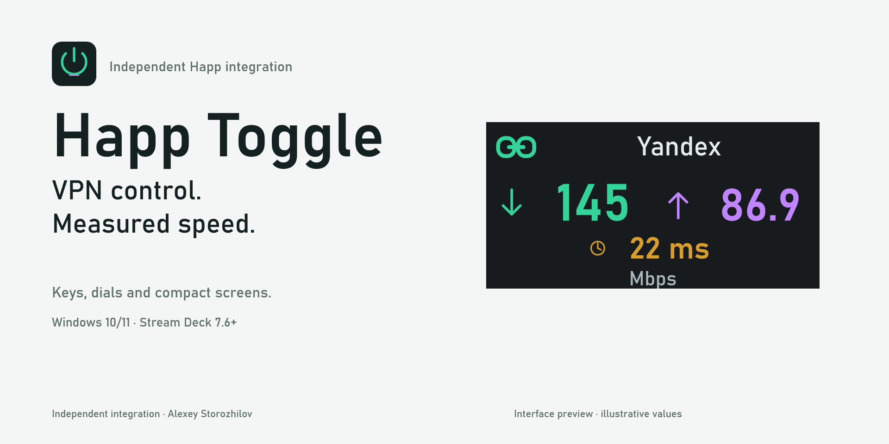

# Happ Toggle



Happ VPN control and measured connection speed for **Elgato Stream Deck**, **Stream Deck+** and **Stream Deck Neo** on Windows.

**Author:** [Alexey Storozhilov](https://github.com/llWHiTE). Independent integration; not affiliated with Happ, Elgato or Ookla. Developed with AI assistance.

> Version 1.12 is a preview. Source syntax and local packages are checked; official Elgato CLI validation and packaging passed, while real-network/device testing is still pending. Gallery measurements are illustrative UI previews, not benchmarks or hardware screenshots.

## Requirements

- Windows 10/11 and Stream Deck 7.6 or later.
- [Happ](https://github.com/Happ-proxy/happ-desktop), installed separately, with `happ://toggle_without_ui` support.
- Windows `curl.exe` and `powershell.exe`. No third-party runtime npm dependencies.

## Install

Download the installer from the [v1.12.0 preview release](https://github.com/llWHiTE/happ-toggle/releases/tag/v1.12.0) and double-click it. See [PUBLICATION.json](PUBLICATION.json) for the verified repository, release assets and validation status. Add **Happ VPN** or **Speed Test** from **Happ Toggle** in Stream Deck.

The public plugin uses `com.llwhite.happtoggle`. Earlier private/test builds used `com.user.happtoggle`: they are different plugins, so public-install actions must be added/configured again. The compatibility installer keeps the old identifier. Do not change the public identifier after publication.

For Stream Deck+, place **Speed Test** on a dial. For Neo, place it on **Infobar** and on a regular key; Infobar is display-only and follows tests on the same device.

## Controls

| Control | Action |
|---|---|
| VPN key: short press | Toggle Happ VPN |
| VPN key: hold | Start/cancel speed test |
| Speed Test key: short press | Start a test; press again to cancel |
| Idle Speed Test key: hold | Cycle Yandex / Cloudflare / Speedtest.net |
| Dial: rotate | Select test service |
| Dial: short press | Start/cancel on release |
| Dial: hold, or tap its screen | Toggle Happ VPN |

Enable **Test speed after connecting** on the VPN key or dial and choose the delay. A confirmed connection following that control's toggle schedules its test. It is not periodic background testing.

## Display

- Download/upload values update as measurements arrive; optional HTTP latency on the screens.
- Latency enabled/disabled uses different number/icon sizes and placement.
- Bahnschrift by default; other explicit font choices remain available.
- Screen status: connection links by default; original power symbol selectable.
- Combined or large-by-phase layout; Mbps/MB/s and optional unit labels.
- Hidden service names, transparent screen fill, independent idle/test animation switches.
- Key results can be held **until the next test**. Screen results remain until replaced or invalidated by a connection/service change.

These are **test services**, not Happ VPN servers. This is a connection test, **not live traffic monitoring**. Delay is HTTP latency after connection setup, **not ICMP ping**. The unofficial Speedtest.net endpoint method is not Ookla's official engine; results need not match a browser. Tests can consume substantial data.

## Privacy and support

See [PRIVACY.md](PRIVACY.md), [SECURITY.md](SECURITY.md) and [third-party notes](THIRD_PARTY_NOTICES.md). No publisher telemetry is implemented. Local proxy/adapter/process status inspection and third-party test traffic are described there.

Support: [author's GitHub profile](https://github.com/llWHiTE). Review diagnostics before sharing; never include credentials, tokens or private proxy configuration.

## Source and packaging

The plugin is in `com.llwhite.happtoggle.sdPlugin/`. Artwork sources are in `media/`; generators are in `tools/`. Native Windows artwork rendering does not require downloaded graphics libraries.

Official validation and packaging, once tool execution is permitted:

```bash
npm --prefix tools ci --ignore-scripts
```

```bash
./tools/node_modules/.bin/streamdeck validate com.llwhite.happtoggle.sdPlugin
```

```bash
./tools/node_modules/.bin/streamdeck pack com.llwhite.happtoggle.sdPlugin --output dist
```

Do not enable DRM without verifying support for this hand-written WebSocket runtime. See [release notes](RELEASE_NOTES.md) and [publication checklist](PUBLISHING.md) for validation status, Marketplace media requirements and remaining decisions.

## License

No open-source license has been selected by the owner yet. Public availability is not a grant of an open-source license. Choose/add a license before describing this project as open source.

## Русский

Happ Toggle переключает Happ VPN и замеряет загрузку, отдачу и HTTP-задержку. Крутилка поддерживает выбор сервиса, короткий запуск/отмену теста и удержание для VPN; касание экрана также переключает VPN. Автозамер включается в настройках VPN-кнопки или крутилки. Экран Neo показывает тесты кнопки того же устройства. Требуются Windows 10/11, Stream Deck 7.6+ и установленный Happ. Публичная копия имеет новый UUID и требует заново добавить действия прежних тестовых сборок.
